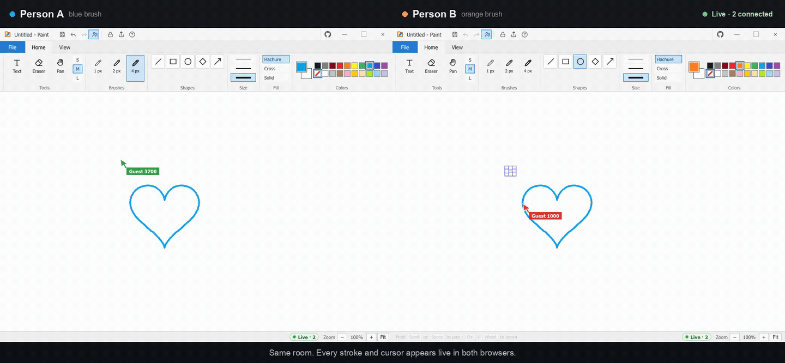

<p align="center">
  
</p>

<h1 align="center">Forme</h1>

<p align="center">
  A fast, local-first whiteboard built in Rust and WebAssembly.
</p>

<p align="center">
  <a href="https://github.com/thisisvaishnav/forme">github.com/thisisvaishnav/forme</a>
</p>

Forme is a browser whiteboard with a paint-inspired ribbon interface. It runs
entirely in the browser, saves your work locally, exports PNG, SVG, and JSON,
and supports live collaboration over WebSockets.

<p align="center">
  
</p>

<p align="center">
  Two browsers in the same room. Every stroke and cursor appears live in both.
</p>

## Features

- **Drawing tools**: select, hand/pan, brush, line, rectangle, ellipse, diamond,
  arrow, text, image, and eraser.
- **Editing**: undo, redo, cut, copy, paste, duplicate, delete, and select all.
- **Navigation**: pan, zoom, zoom-to-fit, and an optional grid.
- **Local-first storage**: the current scene is saved in browser
  `localStorage`.
- **Share links**: encode the current scene in the URL fragment, so the drawing
  is not uploaded to a server.
- **Live rooms**: share a room link and edit together with live elements,
  cursors, names, and colors.
- **Exports**: PNG, SVG, and JSON.
- **Responsive UI**: paint-style title bar, ribbon controls, context menus, and
  keyboard shortcuts.

## Requirements

- [Rust](https://www.rust-lang.org/tools/install) with the
  `wasm32-unknown-unknown` target
- [`wasm-bindgen-cli`](https://rustwasm.github.io/wasm-bindgen/) version
  `0.2.129`
- Docker (optional, for the Vercel container)
- Node.js and npm (optional, for the Vercel CLI)

```bash
rustup target add wasm32-unknown-unknown
cargo install wasm-bindgen-cli --version 0.2.129
```

## Run locally

```bash
./build.sh
cargo run --release --bin forme-serve
```

Open <http://127.0.0.1:8080>.

`build.sh` compiles the WebAssembly client, runs `wasm-bindgen`, and copies the
HTML and CSS into `dist/`. The server serves `dist/` and handles the `/ws`
WebSocket endpoint.

To open the whiteboard to other devices on your network:

```bash
HOST=0.0.0.0 cargo run --release --bin forme-serve
```

Use the printed LAN URL, then click **Edit together live**.

### Server configuration

| Variable | Default | Purpose |
| --- | --- | --- |
| `HOST` | `127.0.0.1` | Address the HTTP/WebSocket server binds to |
| `PORT` | `8080` | Port the server listens on |
| `FORME_DIST` | `dist` | Directory containing the built static client |

Example:

```bash
HOST=0.0.0.0 PORT=3000 FORME_DIST=dist cargo run --release --bin forme-serve
```

## Keyboard shortcuts

| Shortcut | Action |
| --- | --- |
| `V` | Selection |
| `H` | Hand / pan |
| `P` | Brush |
| `L` | Line |
| `R` | Rectangle |
| `O` | Ellipse |
| `D` | Diamond |
| `A` | Arrow |
| `T` | Text |
| `E` | Eraser |
| `Space` + drag | Pan |
| `Ctrl` + wheel | Zoom |
| `Ctrl+Z` | Undo |
| `Ctrl+Shift+Z` | Redo |
| `Ctrl+A` | Select all |
| `Ctrl+C` | Copy selection |
| `Ctrl+X` | Cut selection |
| `Ctrl+V` | Paste |
| `Ctrl+D` | Duplicate selection |
| `Delete` | Delete selection |
| `0` | Reset zoom |
| `Ctrl+S` | Save JSON file |
| `Ctrl+O` | Open JSON file |
| `Ctrl+Del` | New canvas |

## Share links and live collaboration

**Share** copies a link with the scene encoded in the URL fragment. The fragment
is decoded in the browser and is not sent to the server in the HTTP request.

**Edit together live** creates a room and copies an invite link. The client
connects to `/ws?room=<room>` and exchanges element patches, peer information,
and cursor positions. The server keeps rooms in memory and does not persist
them. Live connections reconnect automatically with exponential backoff.

## Deploy to Vercel

The repository includes `Dockerfile.vercel`. Vercel builds it as a Container
Function on Fluid compute, stores the image in Vercel Container Registry, and
routes traffic to it.

```bash
npm i -g vercel
vercel link
vercel --prod
```

At import time:

- Application Preset: **Container**
- Root Directory: repository root
- Build Command and Output Directory: leave empty
- Environment Variables: none

`vercel.json` sets the container framework explicitly. The container runs
`forme-serve` on `$PORT` with `HOST=0.0.0.0`; the default port is `80`.

### Vercel limitations

Vercel closes WebSocket connections when the Function reaches its maximum
duration (300 seconds on the Hobby plan). The client reconnects automatically.

Rooms live in the memory of one container instance. Vercel may route a new
connection to another instance, so long-lived or high-traffic rooms should use
a shared store such as Redis for cross-instance state and pub/sub.

## Project structure

```text
.
├── assets/              # App icon
├── src/
│   ├── app.rs           # UI, canvas interaction, storage, WebSocket client
│   ├── bin/serve.rs     # Static server and WebSocket collaboration server
│   ├── lib.rs           # WASM entry point
│   ├── model.rs         # Scene and element types
│   └── render.rs        # Canvas and SVG rendering
├── web/
│   ├── index.html       # Source HTML and UI
│   └── styles.css       # Source styles
├── build.sh             # WASM build and dist assembly
├── Dockerfile.vercel    # Vercel container image
└── vercel.json          # Vercel container configuration
```

## Data and privacy

- Drawings are stored in the browser under `forme.scene.v1`.
- Share links keep the scene in the URL fragment.
- Live collaboration sends scene patches and cursor data through the configured
  WebSocket server.
- The server stores rooms only in memory; restarting it clears live rooms.

## License

No license has been added yet. All rights are reserved by the repository owner
unless a license is added.
